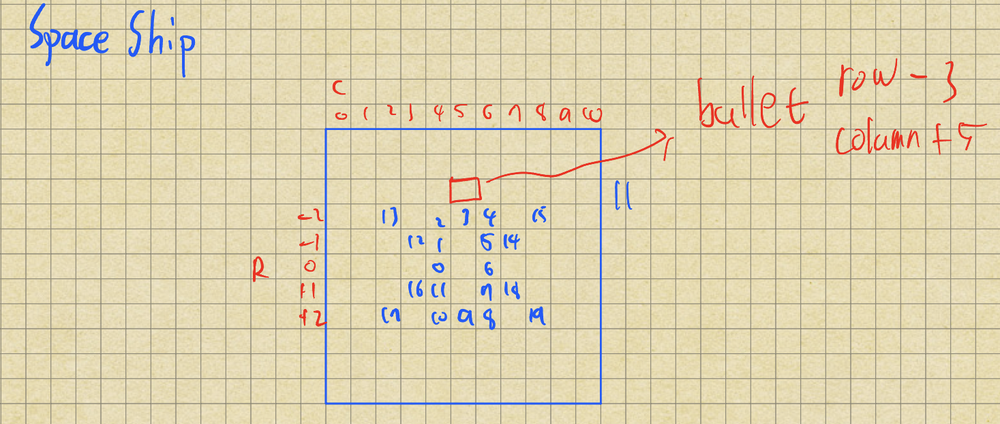
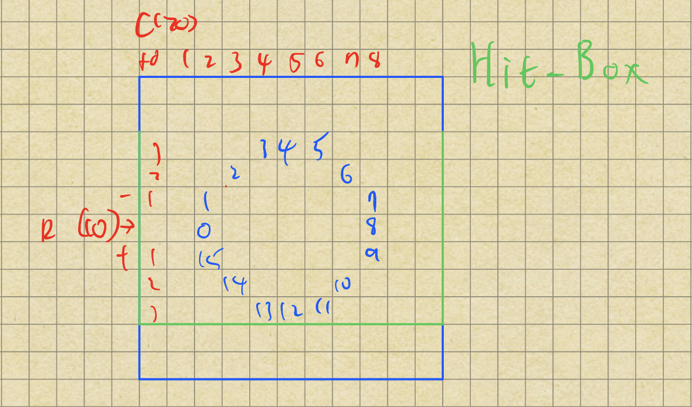

# Game Description
A simplified Space Invaders-like game. The player needs to shoot all the enemies down. There are a total of 10 enemies on the screen. After the game has finished, the console will show how many times each enemy "bounced".

# How to Play
1. Open a terminal window and make it fullscreen.
2. Go into the `src` directory of this project.
3. Use the `make play` command. It will compile and start the game.
4. Follow the instructions in the terminal window.

**Controls**
* Move left: `f`
* Move right: `j`
* Fire: `space`

# Mechanisms Explained
## Rendering
All the pixels are rendered to a canvas (a pixel matrix), and then the canvas is painted onto a virtual terminal window.

## Threads
The game runs 12 threads (the main thread, a spaceship thread, and 10 enemy threads). The spaceship and enemy threads are joined at the end of the game.

## Two-Phase Rendering
The game uses `std::barrier` to create two phases for each frame. Between the phases, each thread waits until all the other threads have arrived. In phase 1, the spaceship thread and all the enemy threads render themselves to the canvas. Each rendering is protected by a `std::mutex`. In phase 2, the main thread paints the complete frame onto the terminal window, and then cleans up the canvas.

## Enemies
Each enemy is a bouncing ball that has 3 shapes and 4 states: full (A), squished (B, D), and flat line (C). The states cycle as A -> B -> C -> D -> A -> B -> C -> D… Since B and D share the same shape, we can see the ball cycling between a full circle and a flat line.
From the picture below, we can see that states A, B, and D have 16 pixels, and state C has 11 pixels. The blue numbers represent the row and column coordinates of each pixel, e.g., 0 is `row[0]` and `col[0]`.
.png)

## Spaceship
A controllable spaceship that can fire bullets. A ship has a vector that stores all the fired bullets.

**Bullet**: Fired by the spaceship. It flies upward until it reaches the ceiling or hits an enemy. All fired bullets are held by the spaceship.

## Shoot Down an Enemy
Collision detection happens in the main loop in phase 2, since in this phase all the other threads are waiting at the barrier and no object renders itself to the canvas.
Once a bullet hits the hit-box of an enemy, the bullet becomes inactive and thus won't be rendered in the next frame. Once an enemy's hit-box gets hit by a bullet, its thread is signaled with `std::atomic_flag`. The enemy thread then leaves its loop, drops out of the barrier with `arrive_and_drop()`, and finishes.

## Moving the Spaceship
Input detection also happens in the main loop in phase 2, for the same reason as above. The spaceship performs an action based on the player's input. One thing that needs to be handled is that the player might keep pressing a single key, which creates a long input buffer. Because each frame can only consume one input, the controls feel choppy if the player keeps hitting the same key and then switches to another key. To deal with this, I use a while loop to consume all the buffered keys and keep only the final input. Since the while loop runs at CPU speed, which is way faster than the keyboard's key-repeat rate, the main loop can always get the latest input in each iteration, thus avoiding input lag.